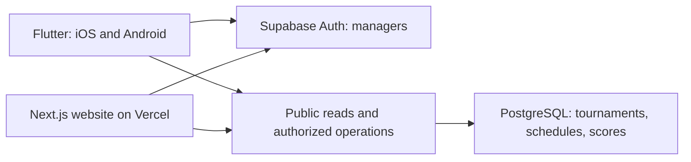

# Architecture and database decision

Status: M0/M1 implementation authorized, 2026-10-16. Database baseline selected; Flutter and Next.js foundations established. Backend operations remain later scope.

## Selection

Use **Supabase-hosted PostgreSQL** for persistence and **Supabase Auth** for manager identity in M2. Start with the free tier subject to the operational limits below. Flutter is the required iOS/Android client. **Next.js with TypeScript on Vercel** is adopted for the M1 website scaffold from the documented recommendation; the user plans to connect GitHub and configure their domain through Vercel.

Why this fits: tournaments, divisions, teams, fixtures, and score revisions form linked records with consistency constraints. PostgreSQL supports that relational model; Supabase provides the database, authentication, and Flutter integration in one service. This is an architectural judgment, not a measured capacity guarantee. See the [Flutter quickstart](https://supabase.com/docs/guides/getting-started/quickstarts/flutter), [row-security documentation](https://supabase.com/docs/guides/database/postgres/row-level-security), and [Next.js on Vercel](https://vercel.com/docs/frameworks/full-stack/nextjs).

## Proposed boundaries

Public viewers do not sign in or create anonymous-auth accounts just to read public data. Both clients use the same persisted tournament and score records.

Recommend server-side transactional operations for match completion, corrections, scheduling publication, and reseeding if approved. Use database functions for transactional invariants and a small server layer only where orchestration needs it; do not duplicate authoritative business logic in Dart and TypeScript.

Realtime updates are an implementation option, not a confirmed latency requirement. Polling versus subscriptions and refresh frequency remain engineering decisions to evaluate against usage.

## Alternatives considered

- A document store such as Firestore is viable but would require more deliberate handling of relational fixtures and cross-record consistency. No offline-first requirement currently offsets that complexity.
- Plain hosted PostgreSQL is viable, but authentication and client-access services would need separate selection.
- Self-hosting adds database operations and backup work without an established hosting need.

These are fit assessments, not claims that alternatives cannot support the app.

## Free-first operating constraints

Current [Supabase pricing](https://supabase.com/pricing) lists a 500 MB database, 5 GB egress, 50,000 monthly active auth users, and two active free projects. Free projects can pause after a week of inactivity, and automatic backups are not included. Pro starts at $25/month. Recheck terms before provisioning.

No known functional requirement forces a paid database today. Unknown audience size and uptime expectations prevent a production-capacity promise. For occasional tournaments, plan to verify availability before an event and define exports/restoration. Do not use synthetic traffic to evade free-plan pausing.

Email-based login/recovery/invites require a production email delivery choice: Supabase's bundled mail sender is restricted and is not a production delivery service. Email/password is now confirmed. Select production email delivery for account recovery, invitations, and confirmation as applicable; provider choice and any cost remain open. See [custom SMTP](https://supabase.com/docs/guides/auth/auth-smtp).

Vercel remains the chosen website host. Its [Hobby plan](https://vercel.com/docs/plans/hobby) permits personal, non-commercial use; public tournaments alone do not establish eligibility. Confirm actual use before claiming free website hosting. App managers are application users, not necessarily paid Vercel team members.

Raise any required paid plan, email service, or other recurring expense to the user before provisioning. No accounts, paid plans, infrastructure, or deployment were created during this phase.

## Repository layout

- `apps/mobile/`: Flutter app.
- `apps/web/`: Next.js web foundation.
- `backend/`: future shared backend definitions and operations, not yet created.
- `specs/`: product/domain contracts and future conformance fixtures.
- `docs/`: decisions, operations, design rules, and project status.
- `.agents/skills/`: project-local reusable guidance.

M1 adds application source, dependency locks, native projects, local configuration guidance, and CI checks. SDKs and generated build output remain outside Git. No database, authentication, or tournament feature is implemented by the foundations.

## Unresolved before implementation

The manager selects eight-team stage format and scheduling policies. Main administration is per tournament, with email/password and admin-invited submanagers. Any signed-in manager can create a tournament and become its main admin. Remaining questions: Q-02 supported ranking alternatives and residual ties; Q-03 scheduling validation/defaults; Q-04 account registration and exact privileges; Q-05 public lifecycle/use constraints; Q-06 mutation rules and smaller-division schedules. See [open decisions](open-decisions.md).

